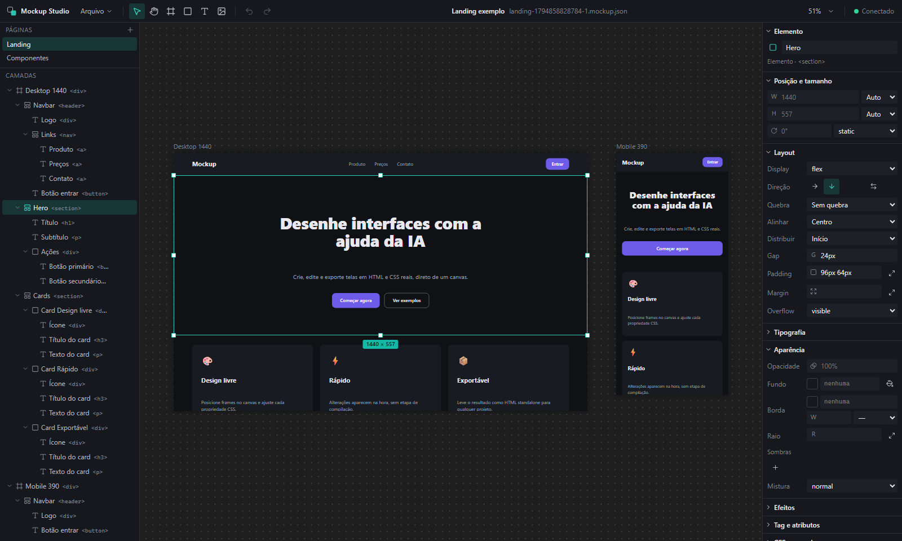

# Mockup Studio

Editor de design em canvas (artboards/frames), voltado para IA, com um servidor MCP capaz de fazer tudo o que a interface faz. Uso pessoal, local, offline-first, sem conta.

Quando você pede um mockup a um agente (Claude Code, Codex), ele usa o app via MCP para criar, inspecionar e editar o design. O documento é HTML e CSS reais em um arquivo JSON legível (`*.mockup.json`).

## Status

MVP — tarefa 3/4 em andamento: monorepo, core, daemon, MCP, editor visual completo e app desktop (Electron) com render/screenshot e empacotamento.



## Requisitos

- Node 24
- npm 11

## Como rodar

```bash
npm install
npm run build
npm test
npm run dev
```

`npm run dev` sobe o daemon em `http://127.0.0.1:4747` e o editor em http://localhost:5173. Nenhum documento é aberto automaticamente: use **Arquivo › Abrir…** ou **Novo…** no editor, ou, em outro terminal:

```bash
node packages/cli/dist/bin.js open examples/landing.mockup.json
```

Ou peça ao agente para chamar a ferramenta MCP `open_document`. Guia do editor, atalhos e medições de desempenho em [docs/EDITOR.md](docs/EDITOR.md).

## App desktop (Electron)

O app desktop abre o editor numa janela nativa (menu em português, diálogos de abrir/salvar), embute o daemon (HTTP, WebSocket e MCP na mesma porta 4747) e o motor de render que gera screenshots PNG/JPG dos nós.

```bash
npm run build                          # core, server, cli, editor e desktop
npm start -w @mockup/desktop           # janela do editor
npm start -w @mockup/desktop -- --headless --port 4747   # sem janela (só daemon + render)
npm start -w @mockup/desktop -- caminho/arquivo.mockup.json   # abre o arquivo
```

- **Headless:** `--headless`, `--port N`, `--data-dir D`. Uma segunda execução repassa os arquivos à instância existente (e abre a janela, se for o caso). Ao fechar a janela com agentes MCP conectados, o app continua rodando sem janela.
- **`mockup mcp` e o Electron:** sem daemon vivo, o CLI sobe o Electron headless (variável `MOCKUP_DESKTOP_EXE`, instalação padrão em `%LOCALAPPDATA%\Programs\Mockup Studio` ou o pacote do monorepo) e o screenshot fica disponível. Sem Electron, cai para o daemon Node (sem screenshot). `MOCKUP_NO_ELECTRON=1` força o daemon Node. Se já houver um daemon Node headless (sem screenshot) iniciado pelo CLI, ele é trocado pelo Electron headless com os mesmos documentos abertos; um `mockup serve` seu não é derrubado (o CLI avisa). `mockup stop` encerra o daemon descoberto (o app com janela recusa: feche-o pela janela). `MOCKUP_DATA_DIR` só é repassada ao app se você a definiu. `mockup serve --render` roda o Electron headless em primeiro plano; `mockup serve` (Node) também serve o editor em `http://127.0.0.1:4747/` se o editor estiver buildado.
- **Render por HTTP:** `GET /render/<docId>/<nodeId>.png?scale=1|2|3&transparent=1`, `.jpg?quality=90` e `.svg`.
- **Empacotar:** `npm run dist` (da raiz, depois do build) gera em `dist/` o instalador NSIS (`MockupStudio-Setup-*.exe`, por usuário, com escolha de pasta) e a versão portátil (`MockupStudio-Portable-*.exe`), além de `dist/win-unpacked/`. Sem assinatura de código.
- **Associação de arquivo (Windows):** o Windows só enxerga a última extensão de `.mockup.json` (`.json`), então o instalador NÃO assume `.json`. Ele registra o ProgID `MockupStudio.Document` e o lista em "Abrir com" dos arquivos `.json`; o app abre o arquivo recebido no argumento. Ícones: `npm run icons -w @mockup/desktop`.

Detalhes de arquitetura em [packages/desktop/README.md](packages/desktop/README.md).

## Testes

```bash
npm test                     # unitários (Vitest) de todos os pacotes
npx playwright install chromium   # uma vez
npm run test:e2e             # e2e do editor (Playwright): sobe daemon e editor em portas de teste
npm run screenshot           # regenera docs/img/editor.png
npm run lint
```

## Registrar o MCP no Claude Code

Com o repositório compilado (`npm run build`):

```bash
claude mcp add mockup-studio -- node <caminho-absoluto>/packages/cli/dist/bin.js mcp
```

Depois de `npm link -w @mockup/cli` (expõe o comando `mockup`):

```bash
claude mcp add mockup-studio -- mockup mcp
```

Alternativa HTTP, com o daemon rodando:

```bash
claude mcp add --transport http mockup-studio http://127.0.0.1:4747/mcp
```

Detalhes e lista de ferramentas em [docs/MCP.md](docs/MCP.md).

## Estrutura do repositório

```
packages/
  core/      @mockup/core    modelo, ops, History, HTML <-> nós, schema zod
  server/    @mockup/server  daemon: documentos, HTTP, WebSocket, MCP
  cli/       @mockup/cli     comando `mockup` (mcp, serve, open, new)
  editor/    @mockup/editor  Vite + React 19 + zustand: editor visual (e2e em editor/e2e)
  desktop/   @mockup/desktop shell Electron, motor de render e empacotamento
docs/        PLANO.md, ARQUITETURA.md, MCP.md, EDITOR.md
examples/    documentos de exemplo
```

## Documentação

- [docs/PLANO.md](docs/PLANO.md): escopo do MVP e fases seguintes
- [docs/ARQUITETURA.md](docs/ARQUITETURA.md): pacotes, formato de arquivo, ops, protocolo WS, HTTP
- [docs/MCP.md](docs/MCP.md): conexão, convenções e ferramentas
- [docs/EDITOR.md](docs/EDITOR.md): uso do editor, atalhos, painéis, arquitetura interna e desempenho
