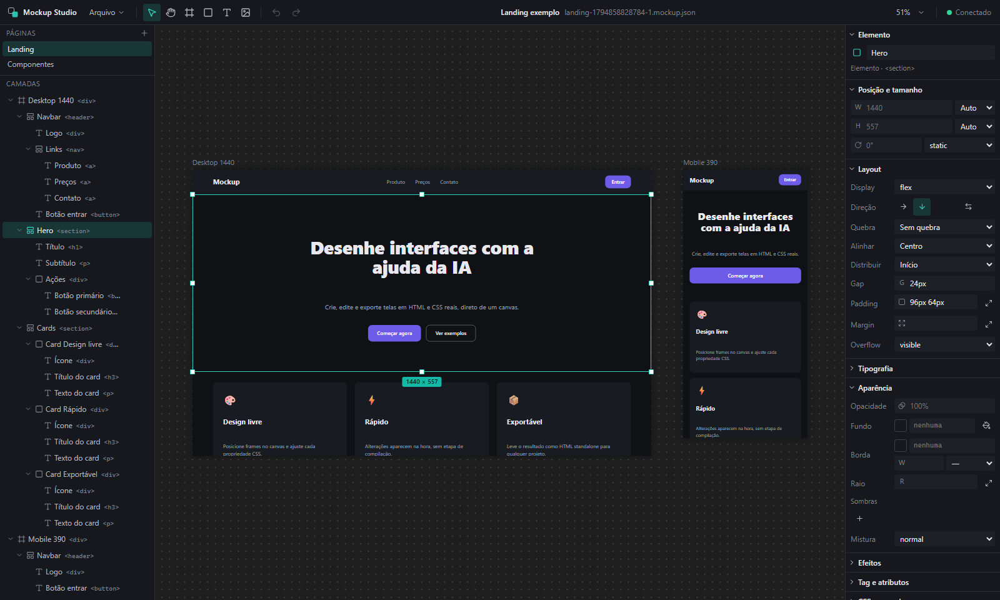

# Editor

Editor visual do Mockup Studio (`packages/editor`, Vite + React 19 + zustand). Roda no navegador (e, na tarefa 3, dentro do Electron) e fala com o daemon por WebSocket. **Toda mutação do documento vira `Op` do core enviada ao daemon (`op:apply`)**; o editor nunca altera o documento localmente. Assim o editor e o MCP veem sempre o mesmo documento, e o undo/redo do daemon vale para os dois.



## Como usar

```bash
npm install
npm run build
npm run dev          # daemon em 127.0.0.1:4747 + editor em http://localhost:5173
```

Abra um documento pelo menu **Arquivo › Abrir…** (caminho do `.mockup.json`), por `mockup open <arquivo>` ou pelo MCP (`open_document`). **Arquivo › Novo…** cria um documento (o daemon acrescenta `.mockup.json` e nunca sobrescreve um arquivo existente).

Fluxo típico: criar um frame (F e arrastar), desenhar containers (R) e textos (T) dentro dele, ajustar no painel de propriedades, mover e redimensionar no canvas, desfazer/refazer, salvar (Ctrl+S; o autosave do daemon também grava 800 ms após a última edição).

## Layout

- **Barra superior**: menu Arquivo (Novo, Abrir, Recentes, Salvar, Salvar como, Fechar), ferramentas, desfazer/refazer, nome do documento com indicador de não salvo (ponto) e seletor quando há vários abertos, zoom e status da conexão. O título da janela mostra o nome do arquivo (com `●` quando há alterações não salvas).
- **Painel esquerdo**: três abas, **Camadas** (páginas e a árvore de camadas da página ativa), **Componentes** (ver [Componentes](#componentes)) e **Tokens** (ver [Tokens e temas](#tokens-e-temas)).
- **Canvas**: infinito, com os frames renderizados como HTML/CSS real.
- **Painel direito**: propriedades da seleção (ou, sem seleção, o nome do documento e um resumo de tokens e temas).

## Canvas

- **Zoom**: Ctrl+roda ou pinça (no ponteiro), `+`/`-`, `Shift+0` (100%), `Shift+1` (ajustar tudo), `Shift+2` (zoom na seleção) e o menu de zoom da barra.
- **Pan**: roda (Shift+roda na horizontal), espaço+arrastar, botão do meio ou a ferramenta Mão (H).
- **Seleção** (regras no estilo das ferramentas de design): clique seleciona o filho direto do frame (ou o irmão da seleção atual); duplo clique desce um nível; Ctrl+clique seleciona o elemento exato; Shift+clique alterna; Esc sobe um nível; arrastar no vazio faz marquee de frames (Shift soma). Clicar ou arrastar o **nome do frame** seleciona/move o frame. Nós travados não são selecionáveis no canvas.
- **Hover** com contorno, pela mesma regra do clique (Ctrl/Cmd mostra o elemento exato); **Alt** mostra a régua de distâncias entre a seleção e o nó sob o ponteiro.
- **Mover**: frames raiz mudam `position`; filhos `position: absolute` mudam `left`/`top`; filhos em fluxo de um pai flex/bloco são **reordenados** com indicador de inserção (`moveNodes` com índice). Shift restringe ao eixo; Esc cancela o arrasto.
- **Redimensionar** pelas 8 alças (`width`/`height` em px); Alt redimensiona a partir do centro; Shift mantém a proporção. O rótulo `W × H` aparece sob a seleção.
- **Criar**: Frame (F) e Container (R) desenhando com arrasto (clique simples cria no tamanho padrão); Texto (T) com clique, já em edição; Imagem (botão da barra, clique no canvas, `Ctrl+Shift+K`, colar ou soltar arquivo) envia o arquivo para `assets/` do documento (`POST /api/assets/:docId`) e cria um nó `img` com `src` relativo. Dentro de pai flex o nó entra no fluxo; em pai bloco vira `absolute` (o pai ganha `position: relative` se for estático).
- **Texto inline**: duplo clique num texto selecionado edita; Enter confirma, Shift+Enter quebra linha, Esc cancela.
- **Menu de contexto** (botão direito, também nas camadas): criar componente, ir para principal, destacar instância, duplicar, agrupar em container, desagrupar, ordem (frente, avançar, recuar, trás), ocultar, travar, excluir.
- **MCP ao vivo**: mudanças feitas por agentes aparecem sem recarregar; a seleção feita pelo MCP (`set_selection`) seleciona e enquadra os nós; frames tocados pelo MCP nos últimos 4 s mostram o badge **IA** pulsante ao lado do nome. A seleção do editor é publicada no daemon (`get_selection`).

## Camadas e páginas

- Árvore com ícone por tipo/tag, nome e tag; expandir/recolher; ocultar (olho) e travar (cadeado).
- Clique seleciona, Ctrl+clique alterna, Shift+clique seleciona o intervalo. Duplo clique renomeia.
- Arrastar linhas reordena ou muda o pai (antes/depois/dentro), inclusive para a raiz da página, na posição atual: texto, imagem e SVG ganham um frame em volta (com 24 px de recuo, como na colagem) e perdem o posicionamento absoluto; contêineres (`element`) viram nós raiz com a posição e o tamanho medidos, mas mantêm `type: element` (o `moveNodes` do core não muda o tipo). Tudo numa única entrada de undo.
- A seleção é sincronizada com o canvas e o MCP (ancestrais expandidos e rolagem até a linha).

## Propriedades

Seções recolhíveis, com multisseleção ("Misto" quando os valores diferem):

- **Nome**, tipo/tag e **Tema** (`data-theme` do elemento; ver abaixo).
- **Posição e tamanho**: X/Y (frames e absolutos), W/H com modo Fixo, Auto, 100% ou Fill (`flex: 1` no eixo principal do pai flex), rotação (`transform: rotate()`), `position`.
- **Layout**: display, direção, gap, quebra, alinhamento, distribuição, padding (vinculado ou por lado), margin, overflow.
- **Tipografia**: família, peso, tamanho, altura de linha, espaçamento, alinhamento, cor, decoração, transformação e o conteúdo do texto.
- **Aparência**: opacidade, fundo (cor, gradiente ou imagem), borda, raio (único ou por canto), sombras múltiplas, `mix-blend-mode` e `background-blend-mode`.
- **Efeitos**: blur do `filter` e do `backdrop-filter` (preservando outras funções).
- **Classes** (Tailwind): ver [Tailwind](#tailwind).
- **Tag e atributos**: tag (op `setTag`), id, href, alt, placeholder, type e atributos livres.
- **CSS avançado**: as propriedades brutas do nó (`prop: valor;` por linha), aplicadas no blur ou com Ctrl+Enter por diff (set/unset).

Inputs numéricos aceitam unidades (`px`, `%`, `rem`, `auto`, `calc()`...), setas ↑/↓ (Shift = ×10) e **arrastar o rótulo** na horizontal (prévia ao vivo, uma única entrada de undo ao soltar).

## Componentes

Modelo, expansão e ops em [COMPONENTES.md](COMPONENTES.md). No editor:

- **Visão expandida**: o `docStore` guarda o documento do daemon em `rawDoc` e expõe em `doc` a **visão** (`expandDocument`, memoizada, com compartilhamento estrutural entre versões). Canvas, índice, camadas, seleção, overlay e propriedades trabalham sobre a visão sem código especial; os planejadores do core (`createComponentOps`, `instanceNodeFor`, `detachInstanceOps`, `importKitOps`...) recebem o `rawDoc`. Uma instância aparece com o id dela (tipo da raiz do principal, `componentId`/`props` como marcador), os nós internos com ids virtuais `in_x/caminho` e o conteúdo de slot com os ids reais.
- **Seleção**: clicar numa instância seleciona a instância; duplo clique desce para os nós internos (como em qualquer filho), Ctrl+clique vai direto. Nós internos **não** se movem, reordenam, duplicam, agrupam nem são excluídos (aviso na tela; nas camadas não são arrastáveis nem renomeáveis), mas estilo, texto (duplo clique), atributos, classes e ocultar viram **overrides** da instância (o daemon roteia as ops). Inserir (ferramentas, colar, soltar) nunca entra num nó interno nem na raiz da instância, só no **conteúdo de slot**, que é nó real: seleciona, edita texto, insere e arrasta como qualquer nó. O contêiner de slot em si não se move.
- **Indicador roxo**: contorno de hover/seleção, alças e rótulo de tamanho roxos em instâncias, nós internos, contêineres de slot e no principal em edição; nas camadas, instância com ícone de componente (roxo forte), nós internos em roxo-claro e contêiner de slot com ícone tracejado.
- **Criar componente** (Ctrl+Alt+K ou menu de contexto): o nó selecionado (não frame raiz, não interno) vira o principal e é trocado pela primeira instância, numa entrada de undo; props inferidas de `{{nome}}` e `data-slot`.
- **Aba Componentes**: busca por nome; **Neste documento** lista os principais (nome, kit, nº de instâncias nas páginas): clique edita o principal, arrastar para o canvas ou o botão + insere uma instância (dentro do contêiner selecionado, logo depois da seleção ou no primeiro frame). Os **kits** do daemon (`GET /api/kits`, ex. **Kit shadcn-like**) inserem com clique ou arrastando: `importKitOps` (se o componente ainda não está no documento; traz os tokens que faltam) e o `createNode` da instância (calculado sobre o documento com o kit aplicado localmente) vão numa única chamada. Solto em pai bloco, a instância fica `absolute` no ponto; fora de frames, ganha um frame em volta.
- **Painel da instância** (seção Instância): componente de origem, um controle por prop (texto, número, liga/desliga, opções, cor com seletor de token) que gera `setInstanceProps` (voltar ao padrão remove a prop), botões dos slots (selecionam o contêiner) e **Ir para principal**, **Destacar** (`detachInstanceOps`), **Restaurar** (remove os overrides; desabilitado sem overrides) e **Enviar ao principal** (`pushOverridesToMainOps`).
- **Modo de edição do principal** (Ir para principal, clique na aba, menu de contexto ou `go_to_main` do MCP): o canvas mostra só a página sintética `COMPONENT_EDIT_PAGE_ID` com a raiz do principal (instâncias aninhadas expandidas) dentro de um quadro tracejado não editável, com a largura da instância de origem; o selo "Editando componente X · N instâncias · **Concluir**" fica no topo. As edições usam os ids reais dos nós do principal (o daemon as transforma em `updateComponent`) e propagam para todas as instâncias; undo/redo normais. O painel mostra a seção **Componente** (nome, descrição e props: adicionar, remover, renomear, tipo, padrão e opções). **Esc** sem seleção (ou Concluir) volta à página de origem e seleciona a instância de onde se entrou; trocar de página também sai do modo. Os textos do principal mostram os placeholders (`{{label}}`).
- **Copiar/colar**: copiar uma instância copia a instância (não a árvore expandida); um nó interno sai como nós concretos. Colar na raiz da página embrulha a instância num frame.

## Tokens e temas

Tudo vira ops enviadas com `daemon.apply` (um undo por ação, o mesmo caminho do MCP); o editor não guarda estado de tokens fora do documento. O canvas e a página de render injetam `.cv-world [data-theme="x"] { --token: … }` (`themeRulesCss`), então o tema de um frame é o atributo `data-theme` e o CSS é o mesmo do export HTML.

### Aba Tokens

- **Lista** agrupada (Cores, Tipografia, Espaçamento, Raio, Sombra, Outros e, no fim, grupos livres), com seções recolhíveis e **busca** por nome, valor ou descrição. Cada linha mostra a prévia (amostra de cor, barra de espaçamento, raio, sombra, família/peso), o nome, o valor e o valor resolvido (`= #fff`) quando difere do declarado.
- **Indicadores**: ícone discreto de _não usado_ (nenhum elemento nem token referencia) e triângulo de _problema_ (vermelho para valor/referência quebrada, âmbar para aviso), com a mensagem no `title` e abaixo da linha.
- **Editar valor**: clique no valor, Enter confirma, Esc cancela. A validação (`validateTokenValue`) bloqueia erros (mensagem sob o campo) e aceita avisos, mostrando-os.
- **Renomear**: duplo clique no nome (`renameToken`, atualiza todos os `var()`).
- **Novo token**: botão `+` (nome, valor, grupo; grupo vazio = inferido).
- **Mais opções** (`⋯` ou botão direito na linha): renomear, editar valor, grupo e descrição (`setTokenMeta`), copiar `var(--x)`, remover sobrescrita do tema, excluir (`planDeleteTokens`; Ctrl+Z desfaz).
- **Tema em edição**: o seletor no topo escolhe _Base_ ou um tema. Com um tema, editar um valor grava na sobrescrita do tema (`setTokens` com `theme`); a linha mostra a etiqueta do tema e o botão para remover a sobrescrita; valores herdados aparecem esmaecidos. Botões para criar (copia o tema atual, se houver), renomear e excluir tema (o `data-theme` dos nós acompanha).
- **Importar** (CSS ou JSON W3C, modo mesclar ou substituir, mostra os avisos do parser) e **Exportar** (CSS, JSON ou Tailwind, com botão Copiar).

### Ligar a token nos inputs

Cada input de cor, tamanho, espaçamento, raio, tipografia (tamanho, altura de linha, espaçamento entre letras, família, peso), cor da borda e da sombra tem um ícone de losango ("Ligar a um token") que abre um seletor com busca e a lista de tokens do tipo da propriedade (cor, espaçamento, raio, tipografia; **Todos** mostra o resto) com o valor resolvido. Escolher grava `var(--token)` (`planApplyToken`) em todos os nós selecionados. Quando o valor já é `var(--x)`, o input vira um **chip** com o nome do token e o valor resolvido no escopo do nó (respeitando `data-theme`); clicar no chip troca o token e o botão de desligar grava o valor resolvido literal. Implementado de forma genérica em `properties/TokenBinding.tsx` (`TokenBound`), plugado nos componentes compartilhados.

### Tema por elemento

A linha **Tema** do painel de propriedades (frames e qualquer elemento) define o `data-theme` (`planSetFrameTheme`); "Padrão (base)" remove. Quando o elemento não declara tema, o select mostra o herdado (`Herdado (dark)`).

### Sem seleção

O painel direito mostra o resumo (nº de tokens e temas, não usados, com problema), o seletor **CSS base** (Padrão / Tailwind (preflight), op `setCssBase`) e o botão "Abrir painel de tokens".

## Tailwind

O Tailwind é nativo no modelo: `node.classes` (classes como escritas), `node.states` (estilos por variante: `hover`, `focus`, `active`, `disabled`, `dark`, `sm`..`2xl` e combinações como `md:hover`) e `Document.cssBase`. O motor (compilador oficial do Tailwind v4, ~260 kB) é carregado **sob demanda**, em chunk separado, só quando a seção Classes aparece ou quando se cola HTML com classes; enquanto carrega a seção mostra "Carregando Tailwind…" e, se o import falhar, mostra o erro sem quebrar o painel.

- **Render com estados**: o canvas e a página de render (`window.__mockupRender.render({ ..., state })`) aplicam `resolveStateStyle` a cada nó. O frame raiz fornece o contexto: um breakpoint vale quando a **largura do frame** (o frame é o viewport; vale a prévia de redimensionamento) é maior ou igual a ele; `dark` vale dentro de um nó com `data-theme="dark"` (para a subárvore) ou na prévia "dark"; pseudo-estados valem na prévia. O contexto só muda ao cruzar um breakpoint, e só nós com `states` reprocessam o estilo.
- **Prévia de estado**: seletor "Prévia" na barra superior (Nenhum, hover, focus, active, focus-visible, focus-within, disabled, dark; `previewState` no `uiStore`). Vale para todos os nós do canvas e não altera o documento.
- **CSS base**: o canvas e o render usam `documentBaseCssFor(doc, ...)`; com `cssBase: 'tailwind'` entra o preflight do Tailwind. Escolha em "CSS base" no painel do documento (sem seleção).
- **Seção Classes**:
  - Campo de classes (Enter ou perder o foco aplica; Shift+Enter quebra a linha; Esc descarta). Aplicar usa `planSetClasses(..., 'replace')`: as classes passam a ser o estilo do nó (`style`, `states` e `classes` mudam numa só chamada, um undo), mantendo o posicionamento (`position`, `left`, `top`...) e o CSS sem classe equivalente quando as classes não os definem. Num nó sem `classes`, o campo abre com as classes equivalentes ao estilo atual (`engine.nodeClasses`); sair sem editar não aplica nada. Multisseleção mostra "Misto" e aplica a todos.
  - Autocomplete (`engine.suggest`) para a classe sob o cursor, inclusive com prefixo de variante (`hover:bg-`): ↑/↓ navegam, Enter ou Tab aceitam, Esc fecha; o CSS da classe destacada aparece no rodapé da lista.
  - Classes desconhecidas ou sem equivalente no modelo aparecem como aviso discreto abaixo do campo.
  - **Mostrar como Tailwind** (lembrado no `uiStore`): as classes idiomáticas do estilo atual do nó, com variantes (`engine.nodeClasses`), somente leitura, com botão Copiar, mais o CSS que não tem classe equivalente. Serve também para nós gerados por CSS, sem `classes`.
  - **Estados**: lista os `states` do nó com o CSS de cada um e um botão para remover (op `setStates`).
- **Colar HTML**: se o HTML colado parece Tailwind (`detectTailwind`), o editor mantém as classes (`htmlToNodes(html, { keepClasses: true })`), compila-as (`applyTailwindToNodes`) e, se o documento ainda não usa o preflight, acrescenta `setCssBase` na mesma chamada (um undo). Como no `import_component` do MCP, se o HTML usa cores do shadcn (`bg-primary`, `border-input`...) que o documento não tem, os tokens do preset shadcn (e o tema `dark`) entram nas mesmas ops, com um aviso na tela, e bordas sem cor recebem `var(--color-border)`. Sem Tailwind, o comportamento é o de sempre.
- **Prévia de estado `dark`**: além das variantes `dark:`, troca os tokens pelo tema `dark` do documento (o frame raiz recebe `data-theme="dark"` só no DOM), como `get_screenshot(state: 'dark')`. Breakpoints (`md:`...) usam as larguras dos tokens `--breakpoint-*` do documento.

## Atalhos

| Atalho                              | Ação                                                                                     |
| ----------------------------------- | ---------------------------------------------------------------------------------------- |
| V / H / F (ou A) / R / T            | Selecionar / Mão / Frame / Container / Texto                                             |
| Ctrl+Shift+K                        | Inserir imagem                                                                           |
| Ctrl+Alt+K                          | Criar componente da seleção                                                              |
| Espaço (segurar)                    | Pan temporário                                                                           |
| Alt (segurar)                       | Régua de distâncias; redimensionar do centro                                             |
| Delete / Backspace                  | Excluir                                                                                  |
| Ctrl+D                              | Duplicar                                                                                 |
| Ctrl+G / Ctrl+Shift+G               | Agrupar em container / desagrupar                                                        |
| Ctrl+] / Ctrl+[                     | Avançar / recuar                                                                         |
| Ctrl+Shift+] / Ctrl+Shift+[         | Trazer para frente / enviar para trás                                                    |
| Ctrl+Shift+H / Ctrl+Shift+L         | Ocultar / travar                                                                         |
| Setas / Shift+setas                 | Mover 1 px / 10 px (reordena filhos em fluxo)                                            |
| Esc                                 | Volta à ferramenta Selecionar; sobe um nível; sem seleção, conclui a edição do principal |
| Enter / Shift+Enter                 | Seleciona os filhos / o pai                                                              |
| Ctrl+A                              | Seleciona irmãos (ou todos os frames)                                                    |
| Ctrl+Z / Ctrl+Shift+Z ou Ctrl+Y     | Desfazer / refazer                                                                       |
| Ctrl+C / Ctrl+X / Ctrl+V            | Copiar / recortar / colar                                                                |
| Ctrl+S / Ctrl+Shift+S               | Salvar / Salvar como                                                                     |
| + / - / Shift+0 / Shift+1 / Shift+2 | Zoom: aproximar, afastar, 100%, tudo, seleção                                            |

Os atalhos são ignorados enquanto o foco está num campo de texto, num diálogo ou na edição inline (exceto Ctrl+S).

## Clipboard

- **Copiar** grava o HTML dos nós (`nodesToHtml`) no clipboard do sistema, com um marcador, e guarda uma cópia interna fiel.
- **Colar**: o conteúdo copiado no próprio editor volta com fidelidade total e **ids novos**; HTML externo (de um navegador, de um agente ou texto que pareça HTML) passa por `htmlToNodes` do core (HTML que parece Tailwind: ver [Tailwind](#tailwind)); imagens viram upload para `assets/`; texto puro vira um nó de texto.
- **Destino**: dentro do nó selecionado (se aceitar filhos), depois dele (se for folha) ou na raiz da página (como frame, no centro da tela).

## Arquitetura interna

| Pasta / arquivo                        | Conteúdo                                                                                                                                       |
| -------------------------------------- | ---------------------------------------------------------------------------------------------------------------------------------------------- |
| `client/daemon.ts`                     | Cliente WS: reconexão, requisições com Promise (`ack`/`error` por `reqId`), integração das mensagens nos stores, upload de assets e recentes.  |
| `state/docStore.ts`                    | Estado do daemon: documentos, documento ativo (`rawDoc`) e a visão expandida (`doc`), histórico (`canUndo`/`canRedo`), atividade do agente.    |
| `state/uiStore.ts`                     | Estado local: seleção, hover, ferramenta, página, viewport, edição de texto, prévias de arrasto, prévia de estado, pedidos de foco, toasts.    |
| `tailwind/`                            | Carga sob demanda do motor Tailwind (`loader.ts`) e o hook `useTailwind`.                                                                      |
| `state/share.ts`                       | Compartilhamento estrutural: objetos de nós que não mudaram mantêm a identidade entre versões do documento.                                    |
| `model/tree.ts`                        | Índice de nós por documento (cache em `WeakMap`) e consultas (pai, cadeia, irmãos, topo da seleção...).                                        |
| `actions.ts`                           | Comandos compartilhados (excluir, duplicar, agrupar, ordem, mover com setas...) com builders puros testados.                                   |
| `canvas/`                              | Canvas, render dos nós, overlay (seleção, alças, marquee, régua), interações, criação, imagem.                                                 |
| `layers/`                              | Páginas e árvore de camadas.                                                                                                                   |
| `components/`                          | Componentes: visão expandida e página do principal (`model.ts`), modo de edição, comandos, kits, aba Componentes, seções Instância/Componente. |
| `properties/`                          | Painel de propriedades e parsers de CSS (sombras, bordas, caixas, filtros, CSS avançado).                                                      |
| `render/`, `desktop/`                  | Página de render (screenshots/medição) e ponte com o app desktop.                                                                              |
| `toolbar/`, `shortcuts/`, `clipboard/` | Barra superior, atalhos e clipboard.                                                                                                           |
| `ui/`                                  | Controles compartilhados (input numérico com unidades, seções, cor, menus, diálogo, toasts).                                                   |

## Salvar como, fontes embutidas e app desktop

- **Salvar como…** (Arquivo, Ctrl+Shift+S) envia `doc:saveAs`: o daemon grava no novo caminho (sobrescreve), copia `assets/` para ao lado do novo arquivo sem sobrescrever o que já existe, e passa a apontar o documento para ele (`doc:saved` com o caminho novo). Recusa um caminho que já é de OUTRO documento aberto. No navegador o caminho é digitado; no desktop abre o diálogo nativo.
- **Fontes embutidas**: o canvas injeta um `<style>` com os `@font-face` de `doc.fonts` (`fontFaceCss` do core, arquivos em `/assets/<docId>/...`), então fontes de `add_font` aparecem como na exportação. As famílias do documento aparecem no seletor de fonte.
- **Indicador "IA"**: o evento `agent:finished` do servidor apaga o selo dos frames dos nós informados (ou de todos, se a lista vier vazia).
- **Ponte desktop** (`desktop/bridge.ts`): com `window.mockupDesktop` (preload do Electron), Novo/Abrir/Salvar como usam os diálogos nativos, o menu nativo aciona os mesmos fluxos (`onMenu`; undo/redo vão para o campo focado quando editável) e o editor informa nome/caminho/não salvo à janela (`setDocumentState`).
- **Página de render** (`render.html`, `src/render/`): gerada junto com o editor em `dist/render.html` e servida em `/render.html`. Não conecta ao WebSocket. `window.__mockupRenderReady` fica `true` ao montar; `window.__mockupRender.render({ doc, docId, nodeId, transparent? })` renderiza só o frame raiz que contém o nó, em (0,0), com o mesmo `NodeView` do canvas (sem sombra, rótulo ou badge), espera fontes, imagens e 2 frames, e devolve `RenderBox`; `measure(nodeId)` devolve a `LayoutNode` medida do último render. Fundo: `transparent: true` deixa html/body transparentes (e usa `color-scheme: normal`; o processo principal deve usar fundo transparente na janela), senão usa o `background` da página do frame.

Prévias de arrasto e redimensionamento (`ui.setPreview`) são transitórias: só ao soltar o editor envia as ops, numa única chamada (= uma entrada de undo).

## Desempenho

Decisões:

- O documento chega completo a cada `doc:changed`; o editor aplica **compartilhamento estrutural** (`shareStructure`), então só os nós alterados (e seus ancestrais) ganham objetos novos.
- `NodeView` e `FrameView` usam `React.memo` por identidade de nó; cada nó assina só a própria prévia de arrasto.
- Seleção, hover, marquee e alças ficam numa **camada de overlay** separada: mudar a seleção ou passar o mouse não re-renderiza a árvore.
- Pan e zoom escrevem o `transform` direto no DOM (sem render do React).
- Linhas de camadas e o painel de propriedades assinam só os nós que exibem.

Medições (Windows, documento com 300 nós em 6 frames × 50):

| Medição                                                        | Resultado                           | Onde                                     |
| -------------------------------------------------------------- | ----------------------------------- | ---------------------------------------- |
| `applyOp` no daemon (`updateStyles`/`setPosition`/`moveNodes`) | ~0,8 / 0,65 / 0,63 ms por op        | `packages/core/src/perf.test.ts`         |
| `JSON.stringify` do documento (custo do `doc:changed`)         | ~0,21 ms                            | `packages/core/src/perf.test.ts`         |
| Clonagem do documento: JSON vs `structuredClone`               | ~0,62 ms vs ~0,87 ms (mantido JSON) | `packages/core/src/perf.test.ts`         |
| Editor: `JSON.parse` + compartilhamento + índice               | ~0,30 + 0,36 + 0,04 ms por mensagem | `packages/editor/src/state/perf.test.ts` |
| Latência MCP `update_styles` → DOM atualizado (ponta a ponta)  | média ~31 ms, máx. ~46 ms (10 ops)  | `packages/editor/e2e/perf.spec.ts`       |
| Arrasto de frame com 50 nós (intervalo entre quadros)          | p95 ~16,7 ms (60 fps)               | `packages/editor/e2e/perf.spec.ts`       |

Com esses números, a clonagem por JSON no core e o documento completo no `doc:changed` ficam bem abaixo de um quadro (16 ms) e foram mantidos; deltas por ops no WS ficam para quando os documentos crescerem uma ordem de grandeza.

## Testes

- Unitários (Vitest, `npm test`): geometria do canvas (clique, inserção flex, redimensionamento, marquee, régua, fit), camadas (drop, achatamento, intervalo), propriedades (parsers e diff de CSS, modos de tamanho, caixas), atalhos, clipboard, comandos, cliente WS, compartilhamento estrutural e índice. Testes de componente com happy-dom.
- E2E (Playwright + Chromium, `npm run test:e2e`): sobe um daemon na porta 4848 com `MOCKUP_DATA_DIR` temporário e o Vite na 5273 apontando para ele. Cobrem criar frame com a ferramenta, HTML via MCP aparecendo ao vivo e seleção sincronizada (editor ↔ MCP), mover e redimensionar, desfazer/refazer, salvar e reabrir, o Tailwind (shadcn no canvas, prévia hover, edição de classes, mostrar como Tailwind, CSS base), o painel de tokens e temas (criar, editar, renomear, tema com sobrescrita, ligar a token e trocar o tema do frame verificando a cor no canvas, avisos de não usado/quebrado, importar e exportar), o fluxo de edição (container, texto inline com quebra de linha, renomear, copiar/colar, duplicar, excluir, nova página), os componentes (Ctrl+Alt+K, instâncias com props pelo painel, edição do principal propagando para 3 instâncias e undo, override de texto e Restaurar, bloqueio de nó interno, kit shadcn-like por clique e arrastando, slot editável, `go_to_main` e Esc) e as medições de desempenho.
- `npm run screenshot` regenera `docs/img/editor.png` com `examples/landing.mockup.json`.
- Portas e pasta do e2e por variável de ambiente: `MOCKUP_E2E_DAEMON_PORT` (padrão 4848), `MOCKUP_E2E_EDITOR_PORT` (padrão 5273) e `MOCKUP_E2E_DIR` (padrão: pasta temporária nova por execução, com os documentos e o `MOCKUP_DATA_DIR` do daemon). `MOCKUP_E2E_DAEMON` é derivada da porta e lida pelos helpers. Mude as portas se o daemon de uso (4747) ou outro processo ocupar as padrão.

Na primeira vez: `npx playwright install chromium`.
