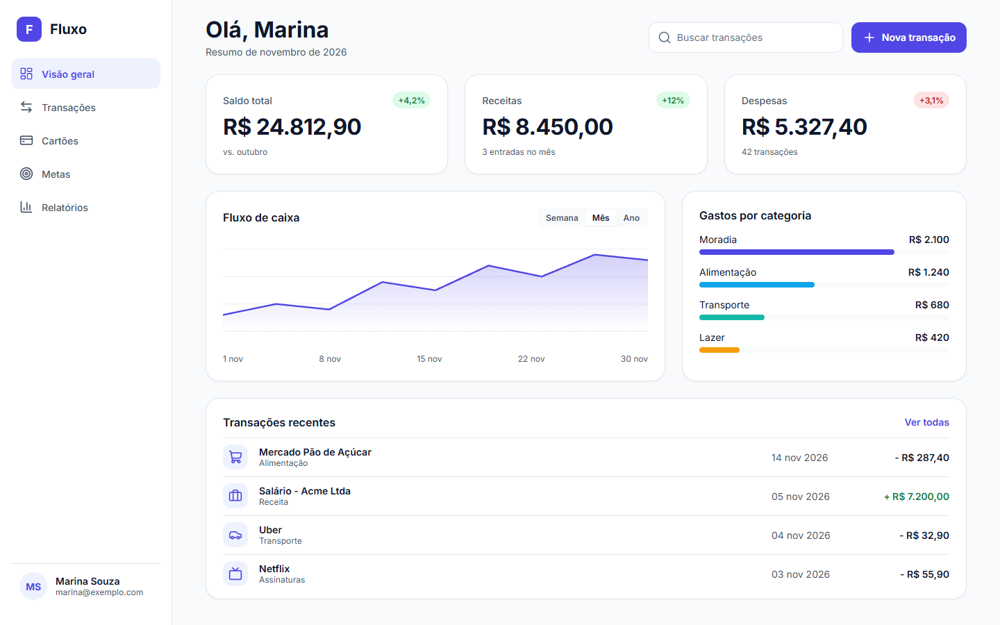
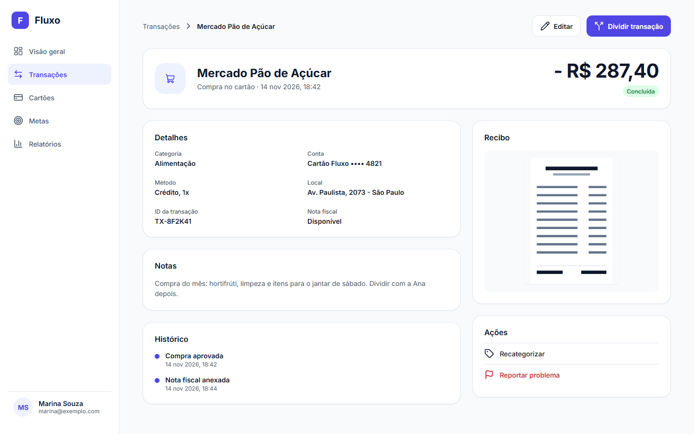
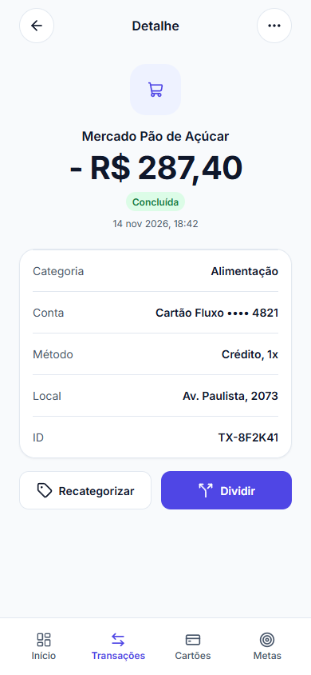
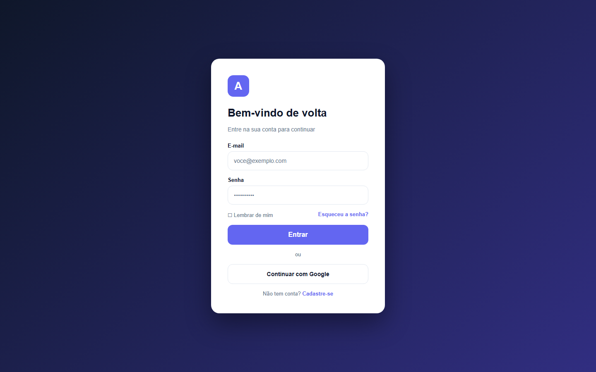

# QA ponta a ponta do MVP (integração com agentes)

Validação do Mockup Studio usado como um agente usa: pelo servidor MCP (`mockup mcp`, stdio), sem tocar na interface. Data: 16/11/2026.

## Ambiente

- Windows 11, Node 24.16.0, `mockup` 0.1.0 instalado por `npm link` (`mockup doctor` sem pendências).
- Daemon: Electron headless (dev), `mode` desktop com render. Registrado em Claude Code 2.1.319 (`mockup mcp`, scope user) e Codex CLI 0.163.0.
- Cliente MCP usado nos testes de ferramenta: SDK `@modelcontextprotocol/sdk` por stdio, rodando `mockup mcp` (script fora do repo, na pasta temporária do sistema). Os mesmos 45 tools que o Claude Code vê.
- Sessões novas: `claude -p ... --allowedTools "mcp__mockup-studio__*" --model sonnet` e `codex exec`, cada uma numa pasta temporária vazia.
- Conferência do código exportado: HTML aberto no Electron, e o React/Tailwind compilados num app Vite + Tailwind v4 temporário (fora do repo). Comparação pixel a pixel contra o `get_screenshot` do mesmo frame.

## 1. Mockup real: app de finanças "Fluxo" (só via MCP)

Documento de exemplo: [`financas.mockup.json`](financas.mockup.json) (com `assets/`: fonte Inter e um recibo PNG). 6 frames numa página, uma linha por tela e breakpoints lado a lado:

| Frame                                         | Tamanho            | Conteúdo                                                                                                                                                                       |
| --------------------------------------------- | ------------------ | ------------------------------------------------------------------------------------------------------------------------------------------------------------------------------ |
| `Login - Desktop` / `Login - Mobile`          | 1440x900 / 390x844 | painel de marca com gradiente e números, formulário, "Manter conectado", botão primário, login social                                                                          |
| `Dashboard - Desktop` / `Dashboard - Mobile`  | 1440x900 / 390x844 | sidebar com ícones Lucide, 3 KPIs com variação, gráfico de área (SVG inline), gastos por categoria, lista de transações; no mobile, cartão de saldo, mini-KPIs e barra de abas |
| `Detalhe da transação - Desktop` / `- Mobile` | 1440x900 / 390x844 | valor em destaque, status, detalhes em grade, notas, histórico, recibo (`insert_image`), ações                                                                                 |

Ferramentas usadas: `get_guide`, `create_document`, `set_tokens` (27 tokens), `add_font` (Inter via Google), `create_frame`, `write_html` (uma tela por chamada, CSS real), `insert_icon`, `insert_image`, `get_screenshot`, `get_layout`, `get_tree_summary`, `update_styles`, `set_text`, `set_attrs`, `rename_nodes`, `delete_nodes`, `export`, `finish_working`.

Iteração com screenshot (imagens lidas uma a uma): o login Desktop teve o título quebrando em "lugar." sozinho (corrigido com `max-width` + `text-wrap: balance`) e, ao trocar a fonte para Inter, o subtítulo passou a quebrar em duas linhas (texto encurtado). No dashboard, a primeira versão ficou com um vazio no rodapé (linha extra de transação) e o gráfico sem eixo (rótulos acrescentados). No detalhe Desktop, `get_layout` mostrou a coluna 20 px além da margem (removido um evento do histórico). Resultado final:

| Desktop                                                  | Mobile                                                 |
| -------------------------------------------------------- | ------------------------------------------------------ |
|                   |                   |
|           |           |
|  |  |

Avaliação visual: hierarquia clara (título 32/24, corpo 14/16, legendas 12), espaçamentos nos múltiplos de 4/8 (tokens `--space-*`), contraste AA (texto secundário `#475569` sobre branco ≈ 7:1; chips verde/vermelho escuros sobre fundos claros), alinhamento conferido com `get_layout`. Limitações: ícones só da biblioteca Lucide; o gráfico é SVG desenhado à mão.

## 2. Exportação

Os 6 frames foram exportados em `html`, `tailwind` e `react` (e `png` 2x e `svg` do login). Comparação do código exportado renderizado contra o screenshot (pixels com diferença forte, depois das correções):

| Frame             | html  | tailwind (CDN) | react (Vite) |
| ----------------- | ----- | -------------- | ------------ |
| Login Desktop     | 0,00% | 0,00%          | 0,00%        |
| Login Mobile      | 0,02% | 0,02%          | 0,02%        |
| Dashboard Desktop | 0,02% | 0,02%          | 0,02%        |
| Dashboard Mobile  | 0,05% | 0,05%          | 0,27%        |
| Detalhe Desktop   | 0,02% | 0,02%          | 0,02%        |
| Detalhe Mobile    | 0,06% | 0,06%          | 0,06%        |

O react compilou com `tsc --strict` e `vite build` sem erros (o único erro de tipo era do arquivo de teste do próprio QA). Antes das correções: o html do login Desktop saía com 660 px de altura (problema 1), e o React em Vite perdia a fonte (problema 3).

## 3. Sessão nova do Claude Code (critério de aceite)

Pedido literal: `crie um mockup de tela de login`, sem instruções extras, só com as ferramentas do `mockup-studio` liberadas.

- Resultado: **passou**. 20 s, 9 turnos, US$ 0,19. Sequência: `ToolSearch` (carregar as ferramentas) → `get_guide('getting-started')` → `create_document` → `set_tokens` → `create_frame` → `write_html` → `get_screenshot` → `finish_working`. Zero erros de ferramenta, zero intervenção.
- Não exportou: o pedido não pedia código. Segunda sessão nova com "crie um mockup de tela de login **e exporte o HTML**": 18 s, 10 turnos, mesma sequência mais `export` (gravou `exports/login-desktop.html`, que abre igual ao screenshot).
- Onde travou: em lugar nenhum. Observações: o agente não chamou `get_basic_info`; deu um screenshot só e não iterou (o resultado já estava bom); escolheu 1280x800 numa sessão e 1440x900 na outra (o guia sugere 1440x900); nomeou tokens sem o padrão `--color-*` do guia (funciona: o prefixo `--` é acrescentado).

 

## 4. Codex

`codex exec` autenticado (ChatGPT). Quatro execuções:

1. Pedido literal, sem AGENTS.md: o Codex **não usou o MCP**; escreveu um `login-mockup.html` à mão (1 min). O texto "mockup de tela de login" não aponta para o servidor.
2. Pedido citando "o servidor MCP mockup-studio": usou `get_guide`, `get_basic_info`, `get_screenshot`, mas `create_document` e `export` foram **bloqueados**: `MCP tool call requires approval, but approval policy is never`. Só ferramentas de leitura passam.
3. Pedido literal com o `AGENTS.md` do snippet no projeto: passou a usar o MCP (`get_guide` e `create_document`), mas com o mesmo bloqueio de aprovação caiu para HTML à mão.
4. `AGENTS.md` do snippet + `-c 'mcp_servers.mockup-studio.default_tools_approval_mode="approve"'`: **fluxo completo** em 1 min: `get_guide` (getting-started e design-system), `create_document`, `set_tokens`, `create_frame`, `write_html`, `get_screenshot` (jpg 800), `export` html, `finish_working`. Gerou `design/login.mockup.json` e `design/exports/desktop.html`.

Conclusão: o Codex funciona de ponta a ponta, mas exige o snippet de AGENTS.md e a aprovação das ferramentas do servidor. Isso está documentado (INTEGRACAO.md e `get_guide('troubleshooting')`) e agora é feito por `mockup setup codex --agents --approve` (P1).

## 5. Tempos medidos

| Operação                                                       | Tempo                |
| -------------------------------------------------------------- | -------------------- |
| `mockup mcp` do zero (sobe Electron headless) até `initialize` | 0,94 s               |
| até o primeiro screenshot (incluindo criar doc, frame e HTML)  | 1,4 s                |
| `get_screenshot` 1440x900, a frio / a quente                   | 430 ms / 60 a 150 ms |
| `get_screenshot` repetido sem mudanças (cache de render)       | 3 a 5 ms             |
| `get_screenshot` jpg 800 px                                    | 54 ms                |
| `export` png 2x                                                | 99 ms                |
| `export` html, tailwind, react, svg (6 frames)                 | 4 a 50 ms            |
| `write_html` (tela inteira)                                    | 3 a 11 ms            |
| `insert_icon` (primeira / demais)                              | 87 ms / 2 a 3 ms     |
| `add_font` google (4 pesos, baixa e embute)                    | 1,2 s                |
| `get_layout`                                                   | 11 a 20 ms           |
| Sessão Claude Code completa (login, 1 screenshot, finish)      | 18 a 23 s            |
| Sessão Codex completa (login, screenshot, export)              | ≈ 60 s               |

Nada lento: o tempo das sessões é do modelo, não do servidor.

## 6. Problemas encontrados

Corrigidos:

| #   | Problema                                                                                                                                                                                                                                                                                                                        | Como reproduzir                                                                                                                 | Status                                                                                                                                                                                                                                                                                                    |
| --- | ------------------------------------------------------------------------------------------------------------------------------------------------------------------------------------------------------------------------------------------------------------------------------------------------------------------------------- | ------------------------------------------------------------------------------------------------------------------------------- | --------------------------------------------------------------------------------------------------------------------------------------------------------------------------------------------------------------------------------------------------------------------------------------------------------- |
| 1   | **Render errado no export:** o html/tailwind/react de um frame cujo wrapper tem `height:100%` colapsa para a altura do conteúdo (login Desktop: 660 px em vez de 900), diferente do screenshot. O frame raiz vira `min-height` e o `%` perde a referência.                                                                      | `create_frame` 1440x900, `write_html` com `<div style="display:flex;width:100%;height:100%">` e `export` html; abrir o arquivo. | Corrigido em 3f8d56f (o filho direto com `height:100%` vira `min-height` do frame; teste em `html.test.ts`).                                                                                                                                                                                              |
| 2   | **Resposta do `export` inflada:** o servidor repetia o código de cada arquivo (até 20 KB por arquivo): exportar 6 frames em 3 formatos devolveu ≈ 170 KB (≈ 40 mil tokens) ao agente.                                                                                                                                           | `export` de 6 frames em `html`.                                                                                                 | Corrigido em 255edce (20 KB no total, o resto só nos arquivos, com aviso; teste em `mcp.render.test.ts`).                                                                                                                                                                                                 |
| 3   | **Fonte e imagens quebradas no React dentro de um projeto Vite:** o `@font-face` e os `src` saem relativos (`assets/...`), e num build o CSS fica em `/assets/`, resultando em `/assets/assets/fonts/...` (a fonte cai no fallback). `assetsBase` existia no core, mas não na ferramenta, e o tema Tailwind ignorava o prefixo. | Exportar react com Inter embutida, copiar para um app Vite, `vite build` e abrir.                                               | Corrigido em 472b4e1 (parâmetro `assetsBase` em `export` e `get_code`) e c2d0f00 (tema tailwind respeita o prefixo); testes em `mcp.render.test.ts` e `react.test.ts`.                                                                                                                                    |
| 4   | `get_basic_info`, que as instruções do servidor mandam chamar logo no começo, devolvia `isError` "Nenhum documento aberto" no estado inicial normal.                                                                                                                                                                            | Sessão nova, `get_basic_info` antes de `create_document`.                                                                       | Corrigido em 969bc60 (resposta normal com o próximo passo; os testes foram ajustados).                                                                                                                                                                                                                    |
| 5   | Guia `design-system` mostrava duas formas de chamar `set_tokens` (`{ "--x": ... }` e `{ tokens: {...} }`) e usava `set_tokens({}, [...])` para remover; `responsive` usava chamadas posicionais (`duplicate_nodes([id])`) que não existem.                                                                                      | `get_guide('design-system')` e `get_guide('responsive')`.                                                                       | Corrigido em 969bc60.                                                                                                                                                                                                                                                                                     |
| 6   | Guia `responsive` não diz como nomear frames com várias telas.                                                                                                                                                                                                                                                                  | Mockup com 3 telas x 2 breakpoints.                                                                                             | Corrigido em 969bc60 (padrão `<Tela> - <Breakpoint>` e linha por tela).                                                                                                                                                                                                                                   |
| 7   | Descrição de `create_document` dizia "com um frame vazio", mas o documento nasce sem frames.                                                                                                                                                                                                                                    | `create_document` e `get_basic_info`.                                                                                           | Corrigido em 969bc60.                                                                                                                                                                                                                                                                                     |
| 8   | Frame de altura fixa esconde overflow: o flexbox espreme os blocos e o screenshot parece caber, mas o código exportado (altura mínima) fica maior (dashboard: gráfico 190 px virou 150 px no canvas).                                                                                                                           | Dashboard com muito conteúdo num frame 1440x900; comparar `get_layout` com o html exportado.                                    | Mitigado em 969bc60 (dica no guia `screenshot-loop`); a causa é inerente ao CSS.                                                                                                                                                                                                                          |
| 9   | Codex: ferramentas que gravam são bloqueadas no `codex exec`, e sem AGENTS.md ele nem usa o MCP.                                                                                                                                                                                                                                | Ver seção 4.                                                                                                                    | Documentado em 7eb5373 (INTEGRACAO.md e guia `troubleshooting`); automatizado em P1.                                                                                                                                                                                                                      |
| P1  | `mockup setup codex` não instalava o snippet de AGENTS.md nem ligava `default_tools_approval_mode = "approve"`; sem isso o Codex ignora o MCP ou é bloqueado.                                                                                                                                                                   | `codex exec "crie um mockup de tela de login"` com o registro padrão.                                                           | Corrigido em 940eb77: `mockup setup codex --approve` grava a chave na seção do servidor e `--agents` acrescenta o snippet ao `~/.codex/AGENTS.md` entre marcadores (só com a flag, idempotentes, preservando o resto); `mockup doctor` avisa quando faltam. Testes em `setup.test.ts` e `doctor.test.ts`. |
| P2  | `set_attrs` em nó `svg` (ex.: `height`) era aceito (`ok`) mas não alterava o markup exportado nem o render.                                                                                                                                                                                                                     | `write_html` com `<svg height="190">`, `set_attrs` `{height:"150"}`, `export` html.                                             | Corrigido em b93cf94: os atributos são mesclados no `<svg>` raiz do markup (sanitizado de novo), com desfazer; teste em `apply.test.ts`. Em a2e41b7, o desfazer em nó `svg` sem markup restaura os `attrs` anteriores.                                                                                    |
| P3  | `add_font` google com 4 pesos gravava 4 arquivos idênticos (Inter é variável) e 4 `@font-face`.                                                                                                                                                                                                                                 | `add_font({family:"Inter", source:"google", weights:[400,500,600,700]})` e olhar `assets/fonts/`.                               | Corrigido em 4da73ff: conteúdo idêntico vira um arquivo só e um `@font-face` com `font-weight:400 700`; documentos antigos continuam válidos. Teste em `mcp.fonts.test.ts` (sem rede). Em 15e08f6, a junção é por estilo: fonte variável com normal e itálico vira dois arquivos.                         |
| P4  | `@font-face` exportado usava `font-display: block` (texto invisível enquanto a fonte carrega).                                                                                                                                                                                                                                  | Abrir o html/React exportado e capturar logo após o load.                                                                       | Corrigido em 4180ffc: `swap` em html, react, tailwind e svg (e no `get_code`); o editor e o render interno seguem com `block` para o screenshot ser determinístico. Teste em `fontdisplay.test.ts`.                                                                                                       |

Pendentes (pequenos ou de design, sem correção aplicada):

| #   | Problema                                                                                                                                                                                                                                          | Como reproduzir                                                       | Justificativa e sugestão                                                                                                                     |
| --- | ------------------------------------------------------------------------------------------------------------------------------------------------------------------------------------------------------------------------------------------------- | --------------------------------------------------------------------- | -------------------------------------------------------------------------------------------------------------------------------------------- |
| P5  | `write_html` descarta `<script>` sem avisar (resposta `ok`, nó vazio).                                                                                                                                                                            | `write_html` com `<div><script>alert(1)</script></div>`.              | Comportamento seguro, mas o agente não sabe que foi descartado. Sugestão: nota "N elemento(s) removido(s): script".                          |
| P6  | Nome de camada vem só da primeira classe: `class="card chart"` vira "Card" (vários nós "Card" no resumo).                                                                                                                                         | `write_html` com classes compostas e `get_tree_summary`.              | Cosmético; o agente pode passar `data-name` ou usar `rename_nodes`. Sugestão: usar a classe mais específica (última) ou `data-name` no guia. |
| P7  | `set_tokens` devolve a lista completa de tokens a cada chamada (27 linhas no meu caso).                                                                                                                                                           | Qualquer `set_tokens` com muitos tokens.                              | Gasto de contexto pequeno; sugestão: devolver só os alterados e a contagem.                                                                  |
| P8  | Daemon e Electron ficam rodando depois que o cliente MCP sai (por desenho: é compartilhado e dura enquanto houver sessões, ou até `mockup stop`). Um cliente que mata o `mockup mcp` sem fechar a sessão HTTP deixa o daemon até o TTL de 30 min. | Matar o processo `mockup mcp` à força e ver `electron.exe` continuar. | Comportamento documentado; só mencionar que testes automatizados devem terminar com `mockup stop`.                                           |

Fora da lista, por observação: as mensagens de erro (nó inexistente, CSS inválido, parâmetro fora da faixa, formato inválido, ícone inexistente, arquivo ilegível) são claras, em português, com exemplo e próximo passo.

## 7. Como repetir

```bash
mockup doctor
claude mcp list        # mockup-studio: ✔ Connected
codex mcp list
# abrir docs/qa/financas.mockup.json no app ou via open_document e rodar get_screenshot em cada frame
mockup stop            # ao terminar
```

## 8. Reexecução do registro depois das correções

Depois das correções do `mockup setup` (não recria um registro igual; lê `~/.claude.json` e `~/.codex/config.toml` em vez de `mcp get`; no Codex edita só `command`/`args`/`env` preservando o resto), nesta máquina:

- `mockup setup claude` e `mockup setup codex`, duas vezes cada: as quatro execuções responderam "já registrado com o mesmo comando; nada a fazer", e o hash de `~/.claude.json` e de `~/.codex/config.toml` ficou igual antes e depois.
- `claude mcp list`: `mockup-studio: mockup mcp - ✔ Connected`. `codex mcp list`: `mockup-studio  mockup  mcp  ...  enabled`.
- `mockup doctor` (≈ 2 s, sem conectar nos clientes) mostra o escopo e o comando registrados e avisa, no Codex, a falta de `default_tools_approval_mode = "approve"` e do trecho no `AGENTS.md`. `--approve`/`--agents` não foram aplicados aqui (mexem na config do usuário); `--print` mostra o que fariam.

Depois da revisão, a troca de transporte do Codex gravava um `config.toml` que o Codex recusava (`env is not supported for streamable_http`, ou `duplicate key` com `env = { ... }` em linha). Corrigido em 3fbff1f: cada transporte remove as chaves do outro, o `env` em linha é editado em linha e o resultado passa por um parser TOML antes de ser gravado. Verificado com o Codex CLI 0.163.0 num `CODEX_HOME` temporário: stdio do app empacotado (com `[mcp_servers.mockup-studio.env]`) → `--http` → stdio de novo, e `--approve`. Em todos os passos `codex mcp list` carregou o arquivo e mostrou o `mockup-studio` e o outro servidor `enabled`. Nesta máquina, `mockup setup claude` e `mockup setup codex` (duas vezes cada) seguem respondendo "nada a fazer", com o hash de `~/.codex/config.toml` igual, e `claude mcp list`/`codex mcp list` seguem com o `mockup-studio` conectado/`enabled`.
